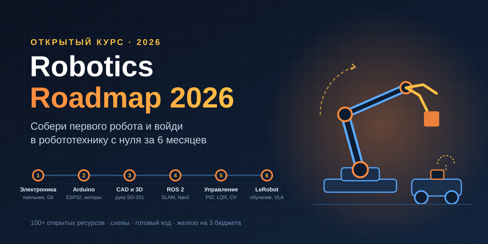
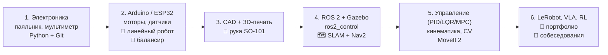

<p align="center">
  
</p>

<p align="center">
  
  
  
  
  
</p>

# 🤖 Robotics Roadmap 2026 — как собрать своего первого робота и войти в робототехнику с нуля

> Пошаговый курс на ~6 месяцев (2–3 часа в день): от закона Ома до робота-манипулятора, который учится по демонстрациям.
> Только открытые и актуальные (2026) ресурсы, схемы подключения, готовые примеры кода и список железа на трёх уровнях бюджета.

Вдохновлено тредом [@DeRonin_ «How to become a Robotics Engineer in 6 months»](https://x.com/DeRonin_/status/2095180126359105955) — материал переработан, структурирован и дополнен схемами и кодом.

---

## Содержание

- [Почему робототехника и кто такой робототехник](#почему-робототехника)
- [Как пользоваться курсом](#как-пользоваться-курсом)
- [Карта курса](#карта-курса)
- [Бюджет: три уровня](#бюджет-три-уровня)
- [Модуль 1. Электроника, инструменты, Python и Git](#модуль-1-электроника-инструменты-python-и-git-недели-14)
- [Модуль 2. Микроконтроллеры, моторы, датчики — первые роботы](#модуль-2-микроконтроллеры-моторы-датчики--первые-роботы-недели-58)
- [Модуль 3. CAD, 3D-печать и робот-рука](#модуль-3-cad-3d-печать-и-робот-рука-недели-912)
- [Модуль 4. ROS 2, симуляция и автономная навигация](#модуль-4-ros-2-симуляция-и-автономная-навигация-недели-1316)
- [Модуль 5. Математика роботов: управление, кинематика, зрение](#модуль-5-математика-роботов-управление-кинематика-зрение-недели-1720)
- [Модуль 6. Обучение роботов, портфолио и работа](#модуль-6-обучение-роботов-портфолио-и-работа-недели-2124)
- [Частые ловушки новичков](#частые-ловушки-новичков)
- [Схемы и примеры кода в репозитории](#схемы-и-примеры-кода-в-репозитории)
- [Дополнительные ресурсы](#дополнительные-ресурсы)

---

## Почему робототехника

- Модели ИИ уже умеют многое — не хватает людей, которые умеют «поместить их в тело».
- Физический мир нельзя спарсить: данные для роботов создаются только руками и реальным железом.
- Порог входа кажется высоким, поэтому конкуренция ниже, чем в «чистом» AI/ML.

**Чем на самом деле занимается робототехник.** Профессия делится на специализации — выбираешь одну, а в остальных ориентируешься:

| Специализация | Что делает |
|---|---|
| Perception / CV | камеры, лидары, облака точек, детекция |
| Controls / State estimation | регуляторы, фильтры Калмана, устойчивость |
| Motion planning / Manipulation | траектории, захват, MoveIt |
| Robot learning | имитационное обучение, RL, VLA-модели |
| Embedded / Firmware | МК, драйверы, реальное время |
| Simulation | Gazebo, MuJoCo, Isaac |
| Systems / Integration | ROS 2, архитектура, железо + софт |

Типичные требования в вакансиях: **C++ и Python** (оба), опыт с **реальным железом**, глубина в одной области, умение **отлаживать**. Диплом конкретной специальности — не обязателен.

---

## Как пользоваться курсом

1. Иди по модулям по порядку. Каждый модуль = ресурсы → фокус → **практическое задание** → чек-лист.
2. Каждый проект — отдельный репозиторий на GitHub с README: фото/видео, схема подключения, код и абзац **«что сломалось и как починил»**. Это и есть портфолио.
3. Не покупай железо заранее — первые недели всё делается в симуляторах бесплатно.
4. Отмечай чек-листы прямо в своём форке этого репозитория.

---

## Карта курса



---

## Бюджет: три уровня

| Уровень | Сумма (≈) | Что входит |
|---|---|---|
| **0** | $0 | Симуляторы: Falstad, Tinkercad, Gazebo, MuJoCo. Весь ROS 2 можно пройти без железа |
| **1** | $45–60 | Стартовый набор Arduino (Elegoo UNO R3 Super Starter Kit) + мультиметр |
| **2** | $110–160 | + паяльник (Pinecil V2), припой, бокорезы, стриппер, макетки, «третья рука» |
| **3** | $200–300 | + лабораторный БП, ESP32-S3, драйверы моторов, шасси, датчики |
| Рука | $120–350 | SO-101 (один follower ≈ $122 + печать, пара leader/follower ≈ $230 + печать, готовые наборы $280–490) |

**Где заказывать:** первый заказ — Amazon / официальный магазин Elegoo (быстро, есть возврат). Adafruit / SparkFun / Pololu — дороже, но к каждому товару есть отличный туториал. AliExpress — в 3–10 раз дешевле, но 2–6 недель доставки и брак без поддержки; переходи туда, когда уже понимаешь, что покупаешь. DigiKey / Mouser — точные компоненты с даташитами. В СНГ: Чип и Дип, Амперка, Ozon/WB для расходников.

Подробный список компонентов: [`docs/hardware-bom.md`](docs/hardware-bom.md).

---

## Модуль 1. Электроника, инструменты, Python и Git (недели 1–4)

**Цель:** читать схему, собрать работающую цепь и найти неисправность, если она не работает.

### 1.1 Основы электроники

| Ресурс | Почему |
|---|---|
| [Falstad Circuit Simulator](https://www.falstad.com/circuit/) | бесплатно, в браузере, видно, как течёт ток |
| [Tinkercad Circuits](https://www.tinkercad.com/circuits) | виртуальная макетка + Arduino + мультиметр |
| [All About Circuits — Textbook](https://www.allaboutcircuits.com/textbook/) | открытый учебник по электротехнике |
| [Afrotechmods](https://afrotechmods.com/tutorials/) | короткие весёлые видео |
| Charles Platt, *Make: Electronics* (3rd ed.) | лучшая бумажная книга для полного новичка (есть русский перевод «Электроника для начинающих») |

**Фокус:** закон Ома и делитель напряжения «на автомате»; ток потребления и почему мотор в стопоре перезагружает МК; символы на схемах; подтягивающие резисторы (pull-up/down); развязывающий конденсатор у каждой микросхемы; основы LiPo (число банок, C-рейтинг, **никогда не заряжать без присмотра**).

**🛠 Практика:** собери делитель в Falstad, посчитай Uвых руками и сверь. Затем — транзисторный ключ, включающий светодиод от логического сигнала 3.3 В (это та самая схема, которой потом пин МК управляет нагрузкой). Схема: [`schematics/01-basics.md`](schematics/01-basics.md).

### 1.2 Инструменты и мультиметр

- [SparkFun: How to Use a Multimeter](https://learn.sparkfun.com/tutorials/how-to-use-a-multimeter)
- [Adafruit Guide to Excellent Soldering](https://learn.adafruit.com/adafruit-guide-excellent-soldering)

**Фокус пайки:** лудить жало и держать его чистым; греть соединение, а не припой; узнавать «холодную» пайку на глаз; сначала выводной монтаж, SMD — сильно позже; флюс решает большинство проблем.

**🛠 Практика:** измерь напряжение батарейки, сопротивление пяти резисторов (сверь с цветовой маркировкой), найди прозвонкой специально порванный провод. Запаяй гребёнку на модуль три раза, прозвони каждый пин, выпаяй и запаяй снова.

### 1.3 Python, терминал, Git

| Ресурс | Почему |
|---|---|
| [CS50P (Harvard)](https://cs50.harvard.edu/python/) | строгий курс с задачами и финальным проектом |
| [Python for Everybody](https://www.coursera.org/specializations/python) | самый мягкий старт |
| [The Missing Semester (MIT)](https://missing.csail.mit.edu/) | shell, скрипты, ssh — робототехника живёт в терминале |
| [Learn Git Branching](https://learngitbranching.js.org/) | интерактивно про ветки |

**🛠 Практика:** с этого дня каждый проект — репозиторий с README (фото, схема, «что сломалось»).

### ✅ Чек-лист модуля 1
- [ ] Читаю схему и собираю по ней цепь на макетке
- [ ] Проверяю номинал резистора расчётом до включения
- [ ] Нахожу КЗ, обрыв и дохлый компонент мультиметром
- [ ] Паяю чистое выводное соединение и проверяю его прозвонкой
- [ ] Пишу скрипт на Python, запускаю из терминала, пушу на GitHub
- [ ] Могу объяснить, почему застопоренный мотор сбрасывает микроконтроллер

---

## Модуль 2. Микроконтроллеры, моторы, датчики — первые роботы (недели 5–8)

**Цель:** робот, который едет, чувствует окружение и сам себя корректирует. Линейный робот — это уже замкнутый контур управления (датчик → регулятор → мотор), то есть «гуманоид в миниатюре».

### 2.1 Arduino

| Ресурс | Почему |
|---|---|
| [Paul McWhorter — Arduino Lessons](https://toptechboy.com/arduino-lessons/) | 100+ уроков с домашками, медленно и понятно |
| [Arduino Built-in Examples](https://docs.arduino.cc/built-in-examples/) | готовые скетчи прямо в IDE |
| [Arduino Docs — Learn](https://docs.arduino.cc/learn/) | справочник по GPIO, PWM, I2C, SPI, UART |
| [Arduino Project Hub](https://projecthub.arduino.cc/) | тысячи проектов со схемами |

**Фокус:** `digitalWrite/Read`, `analogRead/Write`, что такое ШИМ; прерывания и антидребезг; I2C/SPI и поиск адреса в даташите; отладка через Serial; **неблокирующие задержки через `millis()` вместо `delay()`**.

**🛠 Практика:** игра «время реакции» — светодиод загорается через случайное время, кнопка останавливает таймер, результат в Serial. Пример: [`examples/arduino/01_reaction_timer`](examples/arduino/01_reaction_timer/01_reaction_timer.ino).

### 2.2 ESP32

| Ресурс | Почему |
|---|---|
| [Random Nerd Tutorials — ESP32](https://randomnerdtutorials.com/getting-started-with-esp32/) | лучшая бесплатная библиотека туториалов по ESP32 |
| [ESP-IDF Programming Guide](https://docs.espressif.com/projects/esp-idf/en/stable/esp32/get-started/index.html) | «настоящий» фреймворк Espressif |
| [Arduino-ESP32 Core docs](https://docs.espressif.com/projects/arduino-esp32/en/latest/) | мост между Arduino и ESP-IDF |
| [DroneBot Workshop — ESP32](https://dronebotworkshop.com/esp32-2/) | подробные статьи + видео: ESP-NOW, OTA, сон |

**Что выбрать:** Arduino-фреймворк — быстрее всего до работающего робота; ESP-IDF — когда нужен контроль над задачами, ядрами и таймингами; MicroPython — для экспериментов с датчиками, но **не для балансира** (паузы сборщика мусора ломают тайминг). Основная плата — **ESP32-S3**, плюс одна классическая ESP32 для старых туториалов.

**🛠 Практика:** ESP32 раздаёт веб-страницу с показаниями датчика и кнопками, которые крутят сервопривод; открываешь с телефона. Пример: [`examples/arduino/04_esp32_web_servo`](examples/arduino/04_esp32_web_servo/04_esp32_web_servo.ino).

### 2.3 Моторы и драйверы

| Тип | Особенности |
|---|---|
| Коллекторный DC-мотор с редуктором | дёшево, нужен H-мост, без энкодера нет обратной связи — стандарт для первого ровера |
| Хобби-серво (SG90, MG996R) | внутренний контур, ~180°, наружу обратной связи нет |
| «Умный» шинный серво (Feetech STS3215) | цепочка по шине, обратная связь по позиции/скорости/току — на них собраны современные дешёвые руки |
| Шаговый (NEMA17) | открытый контур, точное позиционирование, большой удерживающий момент |

- [DroneBot: DC Motors with L298N](https://dronebotworkshop.com/dc-motors-l298n-h-bridge/)
- [SparkFun TB6612FNG Hookup Guide](https://learn.sparkfun.com/tutorials/tb6612fng-hookup-guide/all)
- [DroneBot: Stepper Motors with Arduino](https://dronebotworkshop.com/stepper-motors-with-arduino/)
- [SimpleFOC docs](https://docs.simplefoc.com/) — бесщёточные моторы и FOC, когда дорастёшь

> ⚠️ **L298N есть в каждом туториале — не используй его в своих роботах.** Это устаревший биполярный мост: теряет ~2 В, греется, сажает батарею. Бери **TB6612FNG** или **DRV8833**.

**🛠 Практика:** крути DC-мотор вперёд/назад на пяти скоростях через ШИМ. Затем добавь энкодер и напиши функцию «ровно один оборот колеса при любом напряжении батареи» — твой первый настоящий замкнутый контур. Схема: [`schematics/02-motor-driver.md`](schematics/02-motor-driver.md), код: [`examples/arduino/02_motor_encoder`](examples/arduino/02_motor_encoder/02_motor_encoder.ino).

### 2.4 Датчики и оценка состояния

| Ресурс | Почему |
|---|---|
| [Kalman and Bayesian Filters in Python (R. Labbe)](https://rlabbe.github.io/Kalman-and-Bayesian-Filters-in-Python/) | лучший бесплатный курс по фильтрам, Jupyter-ноутбуки |
| [MathWorks — Understanding Sensor Fusion](https://www.mathworks.com/videos/series/understanding-sensor-fusion-and-tracking.html) | концептуальный обзор |
| [Adafruit BNO085 guide](https://learn.adafruit.com/adafruit-9-dof-orientation-imu-fusion-breakout-bno085/overview) | IMU с фьюжном на чипе — отдаёт кватернион |

Датчики для старта: HC-SR04 (ультразвук), VL53L0X (ToF-лазер), MPU-6050 (6-DoF IMU, фьюжн делаешь сам — в этом смысл), BNO085, магнитные энкодеры Pololu, лидар RPLIDAR C1.

> 💡 Для балансира сначала напиши **комплементарный фильтр**, а не Калман:
> `angle = a * (angle + gyro * dt) + (1 - a) * accelAngle`, где `a ≈ 0.98`.

**🛠 Практика:** закрепи IMU, выводи угол тангажа, держи плату неподвижно — угол по гироскопу всё равно уплывает. Добавь комплементарный фильтр — дрейф исчезает. Симуляция на Python: [`examples/python/complementary_filter_demo.py`](examples/python/complementary_filter_demo.py), на МК: [`examples/arduino/03_imu_complementary`](examples/arduino/03_imu_complementary/03_imu_complementary.ino).

### 2.5 Первые два робота

**🤖 Робот, едущий по линии** (≈$105 качественная сборка / ≈$38 бюджетная)
ESP32-S3 + шасси Pololu Romi (или 2WD-акрил) + TB6612FNG/DRV8833 + массив датчиков QTR-8RC (или 5× TCRT5000) + аккумуляторы.
Схема: [`schematics/03-line-follower.md`](schematics/03-line-follower.md) · Код: [`examples/arduino/05_line_follower_pid`](examples/arduino/05_line_follower_pid/05_line_follower_pid.ino)

**🤖 Самобалансирующий робот** (≈$134 / ≈$62)
ESP32 + 2 мотора с энкодерами + TB6612FNG + MPU-6050 + печатное шасси + LiPo.
Схема: [`schematics/04-self-balancing.md`](schematics/04-self-balancing.md) · Код: [`examples/arduino/06_self_balancing`](examples/arduino/06_self_balancing/06_self_balancing.ino)

**🛠 Практика:** настрой линейного робота сначала только P-регулятором, потом добавь D и посмотри, как исчезают колебания. **Сними оба видео рядом** — это лучшее доказательство, что ты понимаешь контур, а не скопировал коэффициенты. Балансир не заработает, пока фильтр и тайминг цикла не будут правильными, — и эта боль и есть обучение.

### 2.6 🌉 Мост к ROS 2: прошивка «нижнего уровня»

Последний шаг модуля 2 и вход в модуль 4: ESP32 держит PID **скорости** каждого колеса, а компьютер по USB только говорит «хочу v и ω» и читает энкодеры — так устроены настоящие роботы.

- Прошивка: [`examples/arduino/07_diffdrive_bridge`](examples/arduino/07_diffdrive_bridge) — PID скорости, текстовый протокол в стиле ros_arduino_bridge, авто-стоп при потере связи.
- Хост: [`examples/python/diffdrive_teleop.py`](examples/python/diffdrive_teleop.py) — телеуправление WASD, кинематика дифф-привода, одометрия (x, y, θ) и **встроенный симулятор**: `python diffdrive_teleop.py --sim --demo square` работает вообще без железа.

**🛠 Практика:** проедь квадрат 1×1 м по одометрии и измерь рулеткой, где робот реально остановился. Ошибка в сантиметрах — первая метрика в твоём портфолио. Потом эта же прошивка подключается к ros2_control (модуль 4.5).

### ✅ Чек-лист модуля 2
- [ ] Управляю скоростью мотора и понимаю разницу между скважностью ШИМ и реальными оборотами
- [ ] Читаю энкодер и замыкаю контур по позиции
- [ ] Подключаю I2C-датчик по даташиту без туториала
- [ ] Получаю стабильный угол из акселерометра + гироскопа
- [ ] Объясняю P, I и D через то, что делал мой робот
- [ ] Два работающих робота на GitHub со схемами, кодом и разбором поломок
- [ ] Робот проезжает квадрат по одометрии, ошибка измерена рулеткой

---

## Модуль 3. CAD, 3D-печать и робот-рука (недели 9–12)

**Цель:** спроектировать деталь, изготовить её — и чтобы она подошла.

### 3.1 CAD — выбери один и углубись

| Инструмент | Когда |
|---|---|
| **Onshape Free** | в браузере, отличные сборки/сопряжения; минус — все документы публичны |
| **Fusion (Personal)** | бесплатно для некоммерческого использования, есть CAM |
| **FreeCAD 1.x** | полностью открытый, без облака и лицензий — хорош, если с оплатой/облаком проблемы |
| SOLIDWORKS for Makers | индустриальный стандарт за ~$48/год |

- [Onshape Learning Center — Fundamentals](https://learn.onshape.com/learning-paths/onshape-fundamentals-cad)
- [Learn Fusion in 30 Days (Product Design Online)](https://productdesignonline.com/learn-autodesk-fusion-360-in-30-days-official-course/)
- [MangoJelly Solutions — FreeCAD](https://www.youtube.com/@MangoJellySolutions)
- [Design for 3D printing (Protolabs/Hubs)](https://www.hubs.com/knowledge-base/design-for-3d-printing/)

**Фокус:** полностью определённые эскизы; параметрика через переменные; сборки с шарнирами (revolute/slider/fixed); проектирование вокруг реального железа по чертежу из даташита; STEP для обмена, STL/3MF для печати.

**🛠 Практика:** кронштейн под **твой** сервопривод по чертежу из даташита. Напечатай. С первого раза не подойдёт — в этом урок.

### 3.2 3D-печать

Принтеры для старта: Bambu Lab A1 mini / A1, Creality Ender-3 V3 SE; закрытые — Creality K1C, Bambu P1S.

| Пластик | Для чего |
|---|---|
| PLA / PLA+ | прототипы, оснастка, сама рука SO-101 (PLA+, 15% заполнения, слой 0.2) |
| PETG | «настоящие» детали робота: шасси, корпуса редукторов, крепления |
| ABS / ASA | рядом с горячими моторами, улица; нужен закрытый принтер |
| TPU | ножки, бамперы, мягкие пальцы захвата |
| Нейлон / CF | шестерни и жёсткие звенья (CF требует закалённое сопло) |

- [OrcaSlicer — Calibration wiki](https://github.com/OrcaSlicer/OrcaSlicer/wiki/Calibration)
- [Teaching Tech — Calibration](https://teachingtechyt.github.io/calibration.html)
- [CNC Kitchen](https://www.youtube.com/@CNCKitchen) — тесты прочности печатных деталей
- [Clearance & Tolerance gauge](https://www.printables.com/model/57067-clearance-and-tolerance-3d-printer-gauge)

**Нет принтера?** [Fab Labs](https://fablabs.io/labs), библиотечные мейкерспейсы, [Craftcloud](https://craftcloud3d.com/), [JLC3DP](https://jlc3dp.com/).

**🛠 Практика:** напечатай калибр допусков, запиши реальные зазоры своего принтера, затем спроектируй защёлкивающийся корпус для ESP32 без клея.

### 3.3 Приводы и передачи

Передаточные числа (скорость ↔ момент), **люфт** (его не исправить софтом), подшипники, ремень vs шестерня vs прямой привод, почему пластиковый редуктор дешёвого серво ломается первым.

**🛠 Практика:** напечатай планетарный или циклоидный редуктор для NEMA17 ([пример OpenCycloid](https://www.instructables.com/OpenCycloid-3D-printed-Open-Source-Robotic-Actuato/)), измерь люфт, переделай.

### 3.4 🦾 Робот-рука SO-101 — главная покупка курса

Открытая 5-DoF рука + захват от TheRobotStudio и Hugging Face. Собирается парой **leader + follower**: двигаешь одну рукой — вторая повторяет. Это телеуправление = запись демонстраций для модуля 6.

- Репозиторий и BOM: [TheRobotStudio/SO-ARM100](https://github.com/TheRobotStudio/SO-ARM100)
- Гайд по сборке и калибровке: [LeRobot — SO-101](https://huggingface.co/docs/lerobot/so101)
- Наборы: [Seeed Studio SO-ARM101](https://www.seeedstudio.com/SO-ARM101-Low-Cost-AI-Arm-Kit-Pro-p-6427.html), [печатные детали Seeed](https://www.seeedstudio.com/SO-ARM101-3D-printed-Enclosure-p-6428.html), WowRobo, Robonine

**Дешевле:** $0 — всё в симуляции MuJoCo; $50–80 — [EEZYbotARM MK2](https://www.thingiverse.com/thing:1454048) на MG996R; ~$122 — одна follower-рука без телеуправления; [Hiwonder xArm 1S](https://www.hiwonder.com/products/xarm-1s).

**🛠 Практика:** собери SO-101, откалибруй, управляй follower через leader. Спроектируй свои пальцы захвата из TPU и проверь на трёх предметах разной формы.

### ✅ Чек-лист модуля 3
- [ ] Моделирую деталь по даташиту с полностью определёнными эскизами
- [ ] Знаю реальные зазоры своего принтера из измерений
- [ ] Выбираю PLA / PETG / ABS / TPU под задачу и обосновываю
- [ ] Могу показать люфт на своей конструкции
- [ ] Собрал, откалибровал и доработал робот-руку своими деталями

---

## Модуль 4. ROS 2, симуляция и автономная навигация (недели 13–16)

**Цель:** робот в ROS 2, симуляция, построение карты комнаты и автономная навигация. **Всё можно сделать на обычном ноутбуке без GPU и без железа.**

### 4.1 Какой ROS 2 ставить

| Дистрибутив | Ubuntu | Поддержка | Gazebo |
|---|---|---|---|
| **Jazzy Jalisco** (LTS) ← начинай здесь | 24.04 | до 05.2029 | Harmonic |
| Lyrical Luth (LTS, новейший) | 26.04 | до 05.2031 | Jetty |
| Kilted Kaiju | — | до 12.2026 — не начинай | Ionic |
| Humble Hawksbill | 22.04 | до 05.2027 — legacy | Fortress |

Jazzy — потому что почти все курсы и книги пока на нём. **ROS 1 мёртв** (Noetic EOL 31.05.2025): если в туториале `catkin_make`, `roscore`, `rosrun`, `rospy` — закрывай вкладку. В ROS 2: `colcon build`, `ros2 run`, launch-файлы на Python.

> Нет Ubuntu? Используй Docker-образ `osrf/ros:jazzy-desktop`, WSL2 или браузерную среду The Construct.

### 4.2 Основы ROS 2

| Ресурс | Почему |
|---|---|
| [Официальные туториалы ROS 2 Jazzy](https://docs.ros.org/en/jazzy/Tutorials.html) | канонический справочник |
| [Articulated Robotics (Josh Newans)](https://articulatedrobotics.xyz/tutorials/) | лучший бесплатный путь «от URDF до SLAM на реальном роботе» |
| [MOGI-ROS](https://github.com/orgs/MOGI-ROS/repositories) | полный университетский курс на Jazzy + Gazebo Harmonic, открытый код |
| [Automatic Addison](https://automaticaddison.com/tutorials/) | рецепты под конкретные дистрибутивы |
| [The Construct](https://www.theconstruct.ai/) | ROS в браузере, есть бесплатные курсы |
| [Edouard Renard — ROS 2 for Beginners (Udemy)](https://www.udemy.com/course/ros2-for-beginners/) | платный, но стоит $10–20 по скидке |

**Фокус:** ноды, топики, сервисы, экшены (и когда что); свои `.msg`/`.srv`; параметры и YAML; launch-файлы; colcon-воркспейс; `ros2 bag`. QoS-несовпадение — частая причина «публикую, а никто не получает».

**🛠 Практика:** система из нескольких нод без робота: публикатор датчика → нода обработки → сервис конфигурации, свои сообщения, launch с аргументами, запись в `ros2 bag`. Стартовый пакет: [`examples/ros2/robot_basics`](examples/ros2/robot_basics).

### 4.3 URDF, TF, xacro

- [Articulated Robotics — Coordinate Transforms](https://articulatedrobotics.xyz/category/coordinate-transforms-for-robotics)
- [Официальный туториал URDF + robot_state_publisher](https://docs.ros.org/en/jazzy/Tutorials/Intermediate/URDF/Using-URDF-with-Robot-State-Publisher-cpp.html)

Частые ошибки: путают `joint_state_publisher` (придумывает положения суставов) и `robot_state_publisher` (считает TF из них); нет `<inertial>` → робот взрывается/проваливается в Gazebo; нет статического TF до лидара → SLAM не работает; 400 строк XML руками → используй **xacro**.

**🛠 Практика:** свой робот в xacro (не TurtleBot): дифференциальная база + мачта + pan-tilt голова, с инерциями. Пример: [`examples/ros2/robot_basics/urdf/diff_bot.urdf.xacro`](examples/ros2/robot_basics/urdf/diff_bot.urdf.xacro).

### 4.4 Симуляция

- [Gazebo docs](https://gazebosim.org/docs/latest/getstarted/) — учить первым: родная интеграция с ROS 2. Gazebo Classic мёртв (EOL 01.2025); `ign` → `gz`.
- [MuJoCo](https://mujoco.readthedocs.io/en/stable/overview.html) — точная физика контактов, CPU, стандарт для RL и манипуляции.
- [NVIDIA Isaac Sim](https://docs.isaacsim.omniverse.nvidia.com/) — фотореализм, но нужна мощная RTX-карта.
- PyBullet — не развивается, не начинай на нём.

**🛠 Практика:** твой xacro-робот в Gazebo + плагины лидара и камеры + свой мир с препятствиями; данные видны в RViz.

### 4.5 ros2_control

- [ros2_control docs](https://control.ros.org/rolling/index.html)
- [Articulated Robotics — ros2_control на реальном железе](https://articulatedrobotics.xyz/tutorials/mobile-robot/applications/ros2_control-real/)
- Своя прошивка для этого шага уже есть: [`07_diffdrive_bridge`](examples/arduino/07_diffdrive_bridge) + [diffdrive_arduino](https://github.com/joshnewans/diffdrive_arduino)

**🛠 Практика:** `diff_drive_controller` + `joint_state_broadcaster`, езда с клавиатуры в Gazebo; action-сервер «проехать N метров» с фидбеком и отменой. Сильный пункт в портфолио — его мало кто делает.

### 4.6 SLAM и навигация

- [Nav2 — Getting Started](https://docs.nav2.org/getting_started/index.html) и [Nav2 Tutorials](https://docs.nav2.org/tutorials/index.html)
- [SLAM Toolbox](https://github.com/SteveMacenski/slam_toolbox) — 2D-SLAM по лидару
- [RTAB-Map ROS](https://github.com/introlab/rtabmap_ros) — RGB-D/стерео, 3D-карта

**Фокус:** картирование vs локализация; качество одометрии (размытая карта — почти всегда одометрия); настройка costmap; behavior trees в Nav2.

**Железо:** $0 — Gazebo; $250–450 — своя сборка: RPLIDAR C1 + Raspberry Pi 4/5 + база с энкодерами; $300–535 — готовые Hiwonder MentorPi, Waveshare UGV Rover (Pi + ESP32 — так устроены реальные роботы). Архитектура: [`schematics/05-ros2-rover-architecture.md`](schematics/05-ros2-rover-architecture.md).

**🛠 Практика:** SLAM Toolbox в своём мире → сохранить карту → режим локализации → цели Nav2 из RViz → запись экрана. Видео робота, который сам ездит по построенной им карте, — сильнейший артефакт самоучки.

### ✅ Чек-лист модуля 4
- [ ] Пишу ноды на Python и C++ с топиками, сервисами и экшенами
- [ ] Описываю своего робота в xacro с правильными фреймами и инерциями
- [ ] Симулирую его в Gazebo с лидаром и камерой
- [ ] Управляю через ros2_control, а не сырыми командами
- [ ] Строю карту SLAM Toolbox и езжу автономно через Nav2
- [ ] Чиню сломанное TF-дерево

---

## Модуль 5. Математика роботов: управление, кинематика, зрение (недели 17–20)

**Цель:** понять, что делали библиотеки за тебя. Разница между «умею настроить Nav2» и «умею починить Nav2» — именно здесь.

### 5.1 Теория управления

| Ресурс | Почему |
|---|---|
| [MATLAB Tech Talks — Understanding PID Control](https://www.mathworks.com/videos/series/understanding-pid-control.html) | windup, фильтр D, настройка |
| [Brian Douglas — Control System Lectures](https://www.youtube.com/@BrianBDouglas/playlists) | интуиция без формального курса |
| [Brian Douglas — The Fundamentals of Control Theory](https://engineeringmedia.com/books) | бесплатная книга (CC) |
| [Steve Brunton — Control Bootcamp](https://www.youtube.com/playlist?list=PLMrJAkhIeNNR20Mz-VpzgfQs5zrYi085m) | пространство состояний, LQR, Калман |
| [Åström & Murray — Feedback Systems](https://fbswiki.org/wiki/index.php/Feedback_Systems:_An_Introduction_for_Scientists_and_Engineers) | классический учебник, бесплатный PDF |
| [MATLAB — Understanding MPC](https://www.mathworks.com/videos/series/understanding-model-predictive-control.html) | MPC на пальцах |
| [Russ Tedrake — Underactuated Robotics (MIT)](https://underactuated.csail.mit.edu/index.html) | глубже: ходьба, LQR, оптимизация траекторий |

**🛠 Практика:** на балансире из модуля 2 — P, PD, PID + feedforward, логируй переходные процессы. Затем LQR для cart-pole на Python и сравнение с PID при возмущении: [`examples/python/cartpole_lqr.py`](examples/python/cartpole_lqr.py).

### 5.2 Кинематика и динамика

- [Modern Robotics (Kevin Lynch) — книга, видео, код](http://hades.mech.northwestern.edu/index.php/Modern_Robotics) и [специализация на Coursera](https://www.coursera.org/specializations/modernrobotics)
- [Robotics Toolbox for Python (Peter Corke)](https://github.com/petercorke/robotics-toolbox-python)
- [QUT Robot Academy](https://robotacademy.net.au)
- [PythonRobotics (Atsushi Sakai)](https://github.com/AtsushiSakai/PythonRobotics) — сотни алгоритмов (SLAM, планирование, управление) с анимациями

**🛠 Практика:** прямая и обратная кинематика двухзвенного манипулятора: [`examples/python/two_link_ik.py`](examples/python/two_link_ik.py). Потом — для SO-101 через Robotics Toolbox.

### 5.3 Компьютерное зрение

- [OpenCV Bootcamp (бесплатно)](https://courses.opencv.org/courses/course-v1:OpenCV+Bootcamp+CV0/about)
- [OpenCV — калибровка камеры](https://docs.opencv.org/4.x/dc/dbb/tutorial_py_calibration.html)
- [Cyrill Stachniss (Uni Bonn) — лекции по робототехнике и SLAM](https://www.ipb.uni-bonn.de/online-training-robotics/)
- [Open3D — облака точек](https://www.open3d.org/docs/release/tutorial/geometry/pointcloud.html)

**🛠 Практика:** откалибруй камеру шахматкой, найди ArUco-маркер и оцени его позу в 3D.

### 5.4 Манипуляция и MoveIt 2

- [MoveIt 2 — Getting Started](https://moveit.picknik.ai/main/doc/tutorials/getting_started/getting_started.html)
- [MoveIt Task Constructor — pick and place](https://moveit.picknik.ai/main/doc/tutorials/pick_and_place_with_moveit_task_constructor/pick_and_place_with_moveit_task_constructor.html)
- [Russ Tedrake — Robotic Manipulation (MIT)](https://manipulation.csail.mit.edu/)

**🛠 Практика:** pick-and-place в MoveIt 2 для руки в симуляции; затем позу объекта даёт камера из 5.3.

### ✅ Чек-лист модуля 5
- [ ] Объясняю и реализую PID с anti-windup и фильтрацией D
- [ ] Реализовал LQR и понимаю, когда он лучше PID
- [ ] Решаю прямую и обратную кинематику для простой руки
- [ ] Калибрую камеру и получаю 3D-позу объекта
- [ ] Делаю pick-and-place в MoveIt 2

---

## Модуль 6. Обучение роботов, портфолио и работа (недели 21–24)

**Цель:** научить робота задаче по демонстрациям вместо ручного программирования — и упаковать всё в портфолио.

### 6.1 LeRobot — имитационное обучение на SO-101

- [LeRobot docs](https://huggingface.co/docs/lerobot/index) · [GitHub](https://github.com/huggingface/lerobot)
- [Hugging Face Robotics Course](https://huggingface.co/learn/robotics-course/unit0/1) — без железа
- [SO-101 + LeRobot](https://huggingface.co/docs/lerobot/so101)

Цикл: **телеуправление leader → запись датасета (50+ эпизодов) → обучение политики (ACT / Diffusion Policy / SmolVLA) → запуск на follower → оценка успешности.**

### 6.2 Vision-Language-Action модели

- [openpi (π₀ / π₀.₅, Physical Intelligence)](https://github.com/Physical-Intelligence/openpi)
- [OpenVLA](https://openvla.github.io/)
- [NVIDIA Isaac GR00T](https://github.com/Nvidia/Isaac-GR00T)
- [SmolVLA](https://huggingface.co/lerobot/smolvla_base) — компактная, для доступного железа

### 6.3 Обучение с подкреплением

- [MuJoCo Playground](https://github.com/google-deepmind/mujoco_playground)
- [NVIDIA Isaac Lab](https://github.com/isaac-sim/IsaacLab)
- [Sergey Levine — CS285 Deep RL (UC Berkeley)](https://rail.eecs.berkeley.edu/deeprlcourse)
- [Hugging Face Deep RL Course](https://huggingface.co/learn/deep-rl-course/unit0/introduction)

**🛠 Практика:** запиши датасет «взять кубик и положить в коробку», обучи политику в LeRobot, замерь успешность на 20 попытках, опубликуй датасет и модель на Hugging Face Hub.

### 6.4 Портфолио

Минимум 4–5 проектов, каждый с видео ≤ 60 сек, схемой, кодом и разделом «что сломалось»:

1. Линейный робот: видео «только P» vs «PD»
2. Балансир с графиками угла
3. Своя деталь/редуктор в CAD + замер люфта
4. Робот в ROS 2: xacro → Gazebo → ros2_control → SLAM + Nav2
5. SO-101: телеуправление → датасет → обученная политика

Каждый проект должен выдержать **три уточняющих вопроса на собеседовании**.

### 6.5 Собеседования

Готовься объяснять: PID и что делает каждый член; комплементарный vs Калман; TF-дерево и типичные ошибки; топик vs сервис vs экшен; прямая/обратная кинематика; отладку конкретного бага из своего проекта. Примеры вопросов: [Glassdoor — Robotics Engineer interview questions](https://www.glassdoor.com/Interview/robotics-engineer-interview-questions-SRCH_KO0,17.htm).

### ✅ Чек-лист модуля 6
- [ ] Записал датасет и обучил политику в LeRobot
- [ ] Запустил политику на реальной руке и измерил успешность
- [ ] Понимаю, что такое VLA-модели и когда их применять
- [ ] Портфолио из 4–5 проектов с видео
- [ ] Могу 10 минут рассказывать про каждый проект

---

## Частые ловушки новичков

| Ловушка | Что делать |
|---|---|
| Учебник по теории → бросил на матрицах поворота | Сначала строй, теорию — когда упрёшься |
| Купил Arduino, помигал светодиодом и всё | Сразу ставь цель — робот, который едет |
| ROS 2 без понимания ШИМ и питания | Сначала модули 1–2 |
| Только ML, без железа | Политика бесполезна, если мотор не крутится |
| `delay()` в роботе | `millis()` / таймеры / FreeRTOS |
| L298N | TB6612FNG / DRV8833 |
| Туториалы ROS 1 / Gazebo Classic / `ign` | Проверяй дату и команды |
| Общая земля забыта | GND МК, драйвера и батареи соединены всегда |
| Мотор и МК от одного источника без развязки | Отдельный стабилизатор + конденсаторы |

---

## Схемы и примеры кода в репозитории

```
robotics-roadmap-2026/
├── README.md                      ← этот курс
├── assets/                        ← обложка репозитория
├── docs/
│   └── hardware-bom.md            ← списки компонентов на 3 бюджета
├── schematics/
│   ├── 01-basics.md               ← делитель, транзисторный ключ, pull-up
│   ├── 02-motor-driver.md         ← ESP32 + TB6612FNG + моторы с энкодерами
│   ├── 03-line-follower.md        ← полная схема линейного робота
│   ├── 04-self-balancing.md       ← схема балансира
│   └── 05-ros2-rover-architecture.md ← Pi + ESP32 + лидар в ROS 2
└── examples/
    ├── arduino/
    │   ├── 01_reaction_timer/     ← прерывания, антидребезг, millis()
    │   ├── 02_motor_encoder/      ← ШИМ + энкодер + «ровно 1 оборот»
    │   ├── 03_imu_complementary/  ← MPU-6050 + комплементарный фильтр
    │   ├── 04_esp32_web_servo/    ← веб-сервер на ESP32 + серво
    │   ├── 05_line_follower_pid/  ← линейный робот на PID
    │   ├── 06_self_balancing/     ← балансир
    │   └── 07_diffdrive_bridge/   ← PID скорости колёс + протокол для ROS 2
    ├── python/
    │   ├── complementary_filter_demo.py
    │   ├── cartpole_lqr.py
    │   ├── two_link_ik.py
    │   └── diffdrive_teleop.py    ← телеуправление, одометрия, симулятор
    └── ros2/
        └── robot_basics/          ← пакет ROS 2: ноды, launch, xacro
```

---

## Дополнительные ресурсы

**Сборники**
- [kiloreux/awesome-robotics](https://github.com/kiloreux/awesome-robotics)
- [fkromer/awesome-ros2](https://github.com/fkromer/awesome-ros2)
- [AtsushiSakai/PythonRobotics](https://github.com/AtsushiSakai/PythonRobotics)

**Курсы и платформы**
- [Duckietown](https://duckietown.com/) — открытая платформа для обучения автономному вождению
- [MIT 6.4210 Robotic Manipulation](https://manipulation.csail.mit.edu/)
- [Hugging Face Robotics Course](https://huggingface.co/learn/robotics-course/unit0/1)

**Книги**
- Lynch & Park — *Modern Robotics* (бесплатный PDF)
- Thrun, Burgard, Fox — *Probabilistic Robotics* (классика SLAM и фильтров)
- Peter Corke — *Robotics, Vision and Control*
- Charles Platt — *Make: Electronics*

**Открытые роботы для вдохновения**
- [SO-ARM100/101](https://github.com/TheRobotStudio/SO-ARM100) — рука
- [LeKiwi](https://github.com/SIGRobotics-UIUC/LeKiwi) — мобильная база для SO-101
- [Petoi OpenCat](https://github.com/PetoiCamp/OpenCat) — робот-собака
- [TurtleBot](https://www.turtlebot.com/) — эталонная платформа ROS

---

## Как помочь проекту

Нашёл битую ссылку или знаешь ресурс лучше — открой Issue или Pull Request. Если курс помог — поставь ⭐ и покажи свой первый робот в Discussions.

## Лицензия

Текст курса — [CC BY 4.0](https://creativecommons.org/licenses/by/4.0/), код примеров — MIT. Все внешние ресурсы принадлежат их авторам.
