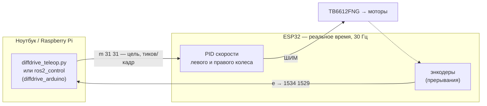

# 07. Мост ESP32 ↔ компьютер для дифференциального робота

Самый полезный «переходный» проект курса: он превращает робота из модуля 2 в базу для ROS 2 из модуля 4.



## Что внутри

| Файл | Что делает |
|---|---|
| [`07_diffdrive_bridge.ino`](07_diffdrive_bridge.ino) | прошивка: PID скорости колёс, текстовый протокол, авто-стоп при потере связи, напряжение батареи |
| [`../../python/diffdrive_teleop.py`](../../python/diffdrive_teleop.py) | хост: телеуправление с клавиатуры, кинематика (v, ω) → колёса, одометрия (x, y, θ), **встроенный симулятор** прошивки |

## Протокол (57600 бод, команда + `\r`)

| Команда | Ответ | Смысл |
|---|---|---|
| `e` | `1534 1529` | счётчики энкодеров L R |
| `r` | `OK` | сброс энкодеров |
| `m 31 31` | `OK` | цель: тиков за кадр PID (1/30 с) |
| `o 400 -400` | `OK` | сырой ШИМ без PID — проверка моторов |
| `u 200:100:0:50` | `OK` | Kp:Kd:Ki:Ko |
| `v` | `7350` | батарея, мВ |

Формат команд взят у [ros_arduino_bridge](https://github.com/joshnewans/ros_arduino_bridge), поэтому прошивку можно подключить к ros2_control через [diffdrive_arduino](https://github.com/joshnewans/diffdrive_arduino) из серии Articulated Robotics (в его конфиге укажи свой порт, 57600 бод, `enc_counts_per_rev` = твой `TICKS_PER_REV`, `loop_rate` = 30).

## Порядок запуска

1. **Без железа:**
   ```bash
   python examples/python/diffdrive_teleop.py --sim --demo square   # квадрат 1×1 м
   python examples/python/diffdrive_teleop.py --sim                 # управление клавишами WASD
   ```
2. **Залей прошивку** (Arduino IDE, плата ESP32 Dev Module, core 3.x). Открой Serial Monitor на 57600, режим «CR», и вручную:
   - `o 300 300` — оба колеса крутятся **вперёд**? Если нет — поменяй `INVERT_LEFT/RIGHT`.
   - `r`, затем крути колесо рукой вперёд и шли `e` — счётчик растёт? Если падает — поменяй местами провода A/B энкодера.
   - Поверни колесо ровно на 1 оборот → значение `e` = твой `TICKS_PER_REV`.
   - `m 20 20` → колёса держат скорость, даже если притормозить пальцем (это и есть PID).
3. **Измерь робота:** радиус колеса и колею → впиши в `diffdrive_teleop.py` (`WHEEL_RADIUS`, `WHEEL_BASE`, `TICKS_PER_REV`).
4. `pip install pyserial` и `python diffdrive_teleop.py --port /dev/ttyUSB0 --demo square`. Измерь рулеткой, где робот остановился, — это ошибка одометрии. Запиши в README своего проекта.

## Настройка PID через Serial
- Колёса медленно разгоняются → увеличь `Kp`.
- Скорость «качается» / моторы дёргаются → увеличь `Kd` или уменьши `Kp`.
- Под нагрузкой скорость ниже цели → немного `Ki` (например `u 200:100:5:50`).

## Задания
1. Калибровка колеи: прокрути робота на 10 оборотов на месте и подбери `WHEEL_BASE`, чтобы одометрия показала ровно 3600°.
2. Добавь команду `i` — вернуть угол с IMU (MPU-6050 из примера 03) и слей его с одометрией по углу.
3. Подключи прошивку к ros2_control через `diffdrive_arduino` и поезди `teleop_twist_keyboard` → затем SLAM Toolbox.
