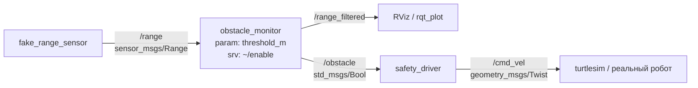

# robot_basics — первый пакет ROS 2 (Jazzy)

Система из трёх нод без железа + xacro-модель робота.



## Установка

```bash
# ROS 2 Jazzy на Ubuntu 24.04: https://docs.ros.org/en/jazzy/Installation.html
# или в Docker:
docker run -it --rm osrf/ros:jazzy-desktop

mkdir -p ~/ros2_ws/src && cd ~/ros2_ws/src
git clone https://github.com/<you>/robotics-roadmap-2026.git
ln -s ~/ros2_ws/src/robotics-roadmap-2026/examples/ros2/robot_basics .
cd ~/ros2_ws
rosdep install --from-paths src --ignore-src -y
colcon build --symlink-install --packages-select robot_basics
source install/setup.bash
```

## Запуск

```bash
# 1. Система нод
ros2 launch robot_basics basics.launch.py threshold:=0.8

# 2. В другом терминале — исследуем граф
ros2 node list
ros2 topic echo /obstacle
ros2 topic hz /range
ros2 param set /obstacle_monitor threshold_m 1.2
ros2 service call /obstacle_monitor/enable std_srvs/srv/SetBool "{data: false}"
rqt_graph

# 3. Пусть черепашка ездит по командам safety_driver
ros2 run turtlesim turtlesim_node --ros-args -r /turtle1/cmd_vel:=/cmd_vel

# 4. Запись и воспроизведение
ros2 bag record /range /obstacle -o my_bag
ros2 bag play my_bag

# 5. Модель робота в RViz с ползунками суставов
ros2 launch robot_basics display.launch.py
```

## Задания
1. Создай пакет `robot_interfaces` (ament_cmake) со своим сообщением `ObstacleInfo.msg` (`float32 distance`, `bool obstacle`, `string sensor_id`) и замени им `std_msgs/Bool`.
2. Перепиши `obstacle_monitor` на C++ (`rclcpp`).
3. Добавь action-сервер «проехать N метров» с фидбеком и отменой.
4. Добавь в xacro теги `<ros2_control>` и плагин лидара, запусти в Gazebo Harmonic (`ros_gz_sim`).
