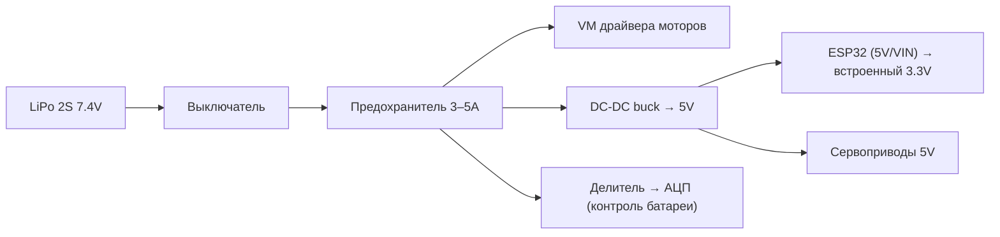

# 01. Базовые схемы

## Делитель напряжения

```
 Vin (5V) ──┬──
            │
           [R1] 10k
            │
            ├────── Vout = Vin × R2 / (R1 + R2) = 2.5V
            │
           [R2] 10k
            │
 GND ───────┴──
```

**Где пригодится:** понизить 5 В с датчика до 3.3 В для ESP32; измерить напряжение батареи через АЦП.
Пример: LiPo 2S (до 8.4 В) → АЦП ESP32 (макс. ~3.1 В): R1 = 20 кОм, R2 = 10 кОм → 8.4 × 10/30 = 2.8 В.

Проверь в [Falstad](https://www.falstad.com/circuit/): File → Import from text, или собери вручную.

## Транзисторный ключ (NPN, нижний ключ)

Пин МК даёт ~10–20 мА. Чтобы включить нагрузку мощнее (светодиодная лента, реле, маленький мотор) — нужен ключ.

```
              +V нагрузки (5–12V)
                  │
              [НАГРУЗКА]        для мотора/реле: диод 1N4007
                  │             параллельно нагрузке, катодом к +V
                  │ C
 GPIO ──[1k]──── B   2N2222 / BC547
                  │ E
                  │
 GND ─────────────┴──── (общая земля МК и питания нагрузки!)
```

Расчёт базового резистора: Iб ≈ Iнагр / 10; Rб = (3.3 − 0.7) / Iб. Для 100 мА → Iб = 10 мА → Rб ≈ 260 Ом (берём 220–330 Ом). Для токов > 300 мА используй **логический MOSFET** (IRLZ44N, AO3400): затвор → GPIO через 100 Ом, затвор → GND через 100 кОм.

## Кнопка с подтяжкой (pull-up)

```
 3.3V
  │
 [10k]   ← или INPUT_PULLUP внутри МК
  │
  ├──── GPIO   (не нажата = HIGH, нажата = LOW)
  │
 [кнопка]
  │
 GND
```

## Развязывающий конденсатор

Каждая микросхема/модуль: **100 нФ керамика** как можно ближе к выводам VCC–GND. Возле драйвера моторов: дополнительно **100–470 мкФ электролит** на питании моторов.

## Типовая схема питания робота



Правило: **все земли соединены в одной точке**, моторы и логика — от разных стабилизаторов.
