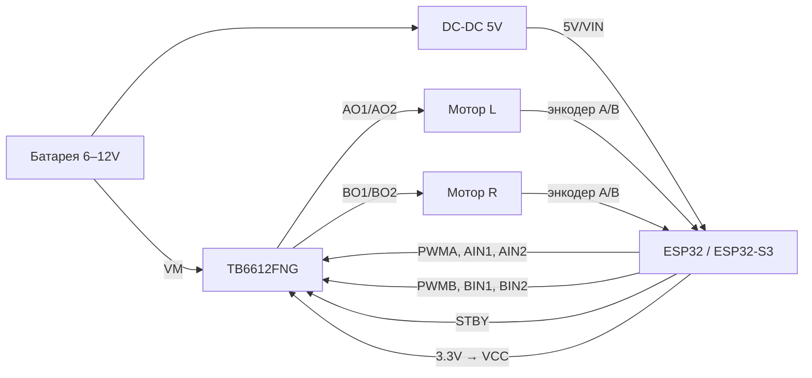

# 02. ESP32 + TB6612FNG + два мотора с энкодерами

Используется в примерах `02_motor_encoder`, `05_line_follower_pid`, `06_self_balancing`.

## Блок-схема

## Таблица подключения

| TB6612FNG | ESP32 GPIO | Назначение |
|---|---|---|
| VCC | 3V3 | питание логики драйвера |
| VM | + батареи (до 13.5 В) | питание моторов |
| GND (все) | GND | **общая земля** |
| STBY | 27 | HIGH = драйвер включён |
| PWMA | 25 | скорость мотора A |
| AIN1 | 26 | направление A |
| AIN2 | 33 | направление A |
| PWMB | 14 | скорость мотора B |
| BIN1 | 12 * | направление B |
| BIN2 | 13 | направление B |
| AO1 / AO2 | — | мотор левый |
| BO1 / BO2 | — | мотор правый |

| Энкодер (Hall, напр. Pololu) | ESP32 GPIO |
|---|---|
| Левый A / B | 34 / 35 (только вход) |
| Правый A / B | 36 (VP) / 39 (VN) (только вход) |
| VCC | 3V3 |
| GND | GND |

\* GPIO12 — strapping-пин; если плата не прошивается, перенеси BIN1 на GPIO 32 (и поменяй константу в коде). GPIO 34–39 не имеют внутренних подтяжек: у большинства модулей энкодеров подтяжки есть на плате, иначе поставь 10 кОм на 3.3 В.

## Таблица истинности TB6612FNG

| IN1 | IN2 | PWM | Результат |
|---|---|---|---|
| H | L | ШИМ | вперёд, скорость = скважность |
| L | H | ШИМ | назад |
| L | L | — | свободный выбег (coast) |
| H | H | — | торможение (brake) |

## Конденсаторы
- 100 мкФ электролит + 100 нФ керамика между VM и GND у драйвера.
- 100 нФ на выводах каждого мотора (снижает помехи от щёток).
