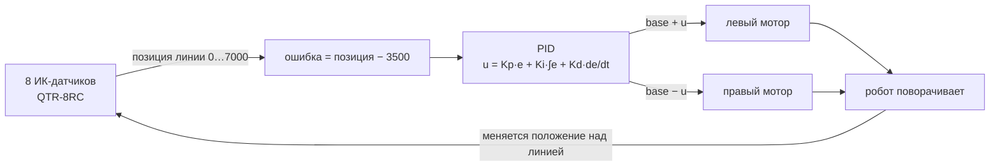

# 03. Робот, едущий по линии (ESP32 + TB6612FNG + QTR-8RC)

## Принцип



## Подключение

Моторы и драйвер — как в [02-motor-driver.md](02-motor-driver.md).

| QTR-8RC | ESP32 GPIO |
|---|---|
| VCC | 3V3 (или 5V — выходы RC совместимы с 3.3 В при питании 3.3 В) |
| GND | GND |
| 1…8 | 15, 2, 4, 16, 17, 5, 18, 19 |
| LEDON (CTRL) | 23 |

```
            вид сверху
   ┌───────────────────────────┐
   │  [QTR-8RC]  ← 3–8 мм над полом
   │                           │
   │   ESP32      TB6612       │
   │                           │
 [колесо L]   батарея    [колесо R]
   │                           │
   └─────────(шаровая опора)───┘
```

## Бюджетная версия (5× TCRT5000)

Каждый датчик: ИК-светодиод через 220 Ом на 3.3 В, фототранзистор — коллектор к 3.3 В через 10 кОм, сигнал с коллектора на АЦП (GPIO 32, 33, 34, 35, 36). Позицию считаем как взвешенное среднее: `pos = Σ(value_i × i × 1000) / Σ value_i`.

## Трасса
Чёрная изолента 19 мм на белом ватмане/ДВП. Начни с плавного овала, потом добавляй повороты 90°.

## Настройка PID (порядок)
1. `Ki = Kd = 0`, базовая скорость 30–40 %. Увеличивай `Kp`, пока робот не начнёт раскачиваться, затем уменьши на ~30 %.
2. Увеличивай `Kd`, пока раскачка не исчезнет.
3. `Ki` — маленький или 0 (на линии почти не нужен).
4. Подними скорость и повтори.
5. **Сними видео P-only и PD** — это лучший кадр для портфолио.
