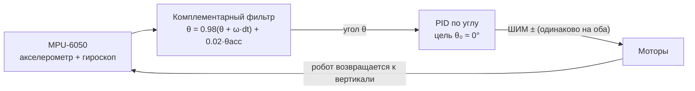

# 04. Самобалансирующий робот (ESP32 + MPU-6050 + TB6612FNG)

## Контур управления



Цикл должен идти с **фиксированной частотой** (200 Гц = 5 мс) — без `delay()`.

## Подключение

Моторы — как в [02-motor-driver.md](02-motor-driver.md).

| MPU-6050 | ESP32 |
|---|---|
| VCC | 3V3 |
| GND | GND |
| SDA | GPIO 21 |
| SCL | GPIO 22 |
| AD0 | GND (адрес 0x68) |
| INT | не обязателен (GPIO 19) |

## Механика

```
        ┌─────────┐  ← батарея наверху (выше центр масс = медленнее падает = легче балансировать)
        │ LiPo 2S │
        ├─────────┤
        │  ESP32  │
        │  MPU    │  ← IMU жёстко закреплён, ось X вдоль направления движения
        ├─────────┤
        │ TB6612  │
   (O)══╧═════════╧══(O)   ← моторы с редуктором 1:30…1:50, колёса 65–80 мм
```

## Настройка
1. Найди угол равновесия `θ₀`: держи робота в точке баланса, смотри угол в Serial.
2. `Ki = Kd = 0`; увеличивай `Kp`, пока робот не начнёт «пытаться» стоять и колебаться.
3. Добавь `Kd` — колебания гасятся.
4. Малый `Ki` убирает медленный уход вперёд/назад.
5. Следующий шаг — второй (внешний) контур по скорости с энкодеров, чтобы робот не уезжал.

## Частые проблемы
| Симптом | Причина |
|---|---|
| Робот сразу падает в одну сторону, моторы «помогают» падать | перепутан знак: инвертируй выход PID или направление моторов |
| Высокочастотная дрожь | слишком большой `Kd` или шумный гироскоп → включи DLPF MPU-6050 (регистр 0x1A) |
| Работает, потом сбрасывается ESP32 | просадка питания от моторов → отдельный DC-DC, конденсаторы |
| Угол медленно уплывает | неоткалиброван гироскоп → усредни 500 измерений в покое при старте |
