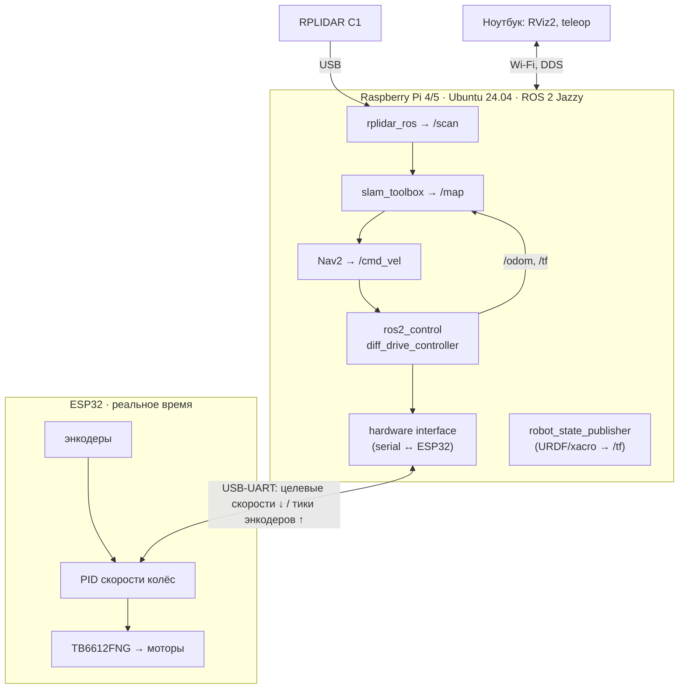

# 05. Архитектура ROS 2-ровера (Raspberry Pi + ESP32 + лидар)

Так устроены реальные роботы: **высокоуровневый компьютер** (Linux, ROS 2, SLAM, навигация) + **контроллер реального времени** (моторы, энкодеры, IMU).



## Протокол Pi ↔ ESP32 (простой текстовый, как в проекте ros_arduino_bridge / diffdrive_arduino)

| Команда (Pi → ESP32) | Ответ | Смысл |
|---|---|---|
| `m 120 -120\r` | `OK` | целевые скорости колёс, тиков за цикл PID |
| `e\r` | `10234 -10190` | текущие счётчики энкодеров |
| `r\r` | `OK` | сброс энкодеров |

Готовые реализации: [joshnewans/ros_arduino_bridge](https://github.com/joshnewans/ros_arduino_bridge) (прошивка) + [joshnewans/diffdrive_arduino](https://github.com/joshnewans/diffdrive_arduino) (hardware interface для ros2_control) — используются в серии Articulated Robotics. Альтернатива для ESP32 — [micro-ROS](https://micro.ros.org/).

## Питание
- Pi 5: стабильные 5 В / 5 А (отдельный DC-DC, не от того же, что моторы!).
- Моторы: напрямую от батареи через драйвер.
- Общая земля.

## TF-дерево (должно быть ровно так)

```
map → odom → base_link → laser_frame
                       → camera_link
                       → left_wheel / right_wheel
```

`map → odom` публикует SLAM, `odom → base_link` — diff_drive_controller, остальное — robot_state_publisher из URDF. Проверка: `ros2 run tf2_tools view_frames`.
